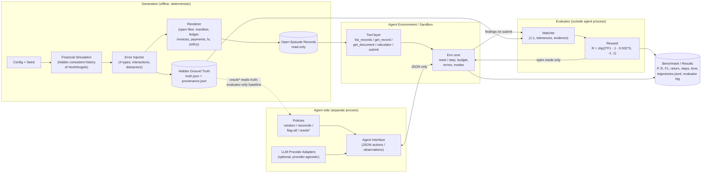
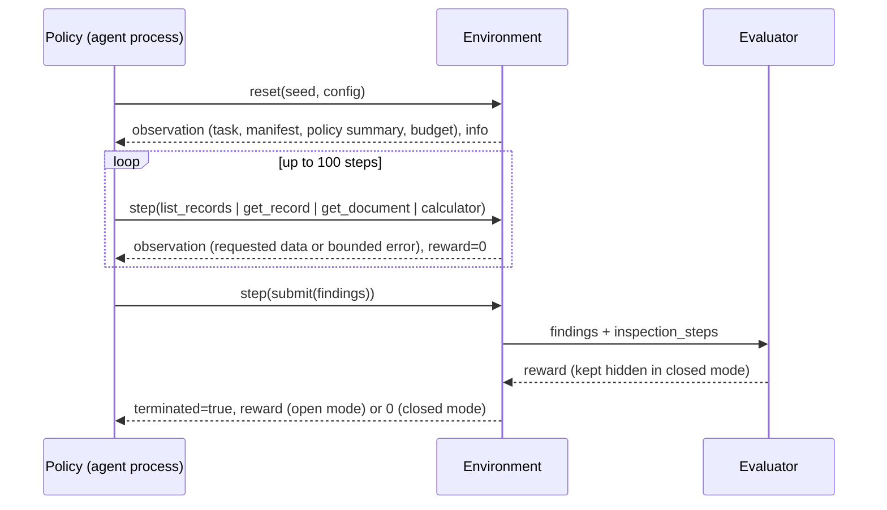

# Architecture (high level)

Status: proposal for review. No technology choice is final except where the brief fixes it.
The brief suggests Python 3.11 as the offline target and a JSON-compatible Gymnasium-style contract.

## 1. Component diagram

`oracle*` is a baseline that reads ground truth to produce perfect findings. It exists only to
verify the maximum reward [OFFICIAL CASE]. It runs in an evaluator-only harness and must never
be the path through which other policies see truth.

## 2. Components

| Component | Responsibility | Must not |
|---|---|---|
| Config + Seed | All randomness comes from the seed. Config sets sizes, error mix, distractors, difficulty. | Be visible to the agent in closed mode |
| Financial Simulation | Build the consistent hidden history (customers, invoices, deliveries, payments, FX). Check invariants. | Contain any error |
| Error Injector | Apply configured errors to the history. Record the causal change, affected ids, expected amount, and evidence sets. Verify evidence is reachable. | Produce unprovable or contradictory issues |
| Renderer | Turn the history into the official open file formats. Shuffle, randomize ids, apply timezone offsets. | Leave injection artifacts (ordering, id patterns, formatting) |
| Tool layer | Implement the five actions over read-only data. Pagination, stable cursors, safe calculator. | Expose paths, truth, or exceptions |
| Env core | `reset`/`step`, 100-step budget, time limit, `terminated`/`truncated`, open vs closed mode. | Hand out internal object references |
| Agent Interface | Serialized JSON action/observation protocol. One adapter per policy type. | Depend on a specific LLM provider |
| LLM Provider Adapters | Optional. Map the action contract to provider tool-calling APIs. | Be required for the official offline check |
| Matcher | Normalize, check type/ids/amount/currency/evidence, do one-to-one assignment, count TP/FP/FN. | Read `explanation` for scoring |
| Reward | Official formula. Optional experimental reward reported separately. | Replace the official formula |
| Benchmark / Results | Run the four baselines on episode sets. Write trajectories and metrics. | Write truth into trajectories |

## 3. Episode lifecycle

## 4. Reward (official, unchanged)

`R = clip(2 * F1 - 1 - 0.002 * S, -1, 1)`

- `F1 = 2TP / (2TP + FP + FN)`. If truth and findings are both empty, F1 = 1. If truth is empty
  but findings exist, F1 = 0. P and R are 0 on a zero denominator [OFFICIAL CASE].
- `S = inspection_steps`. Whether `submit` itself counts as an inspection step is open question
  G1 (recommended: count only non-submit actions).
- Malformed submission -> R = -1. Truncation -> empty findings scored normally.
- Return of an episode = this terminal reward. Intermediate rewards are 0.

Expected behaviour (to be proven by tests [OFFICIAL CASE]):

| Situation | F1 | R (approx.) |
|---|---|---|
| Perfect answer, 40 steps | 1.0 | 0.92 |
| Silence on books with errors | 0.0 | -1.0 |
| Silence on a clean company, 20 steps | 1.0 | 0.96 |
| Any finding on a clean company | 0.0 | -1.0 |
| 3 true errors, flag 30 findings with 3 TP, 30 steps | 6/33 = 0.18 | about -0.70 |
| Same perfect answer, 20 vs 60 steps | 1.0 | 0.96 vs 0.88 (small difference) |

Additional diagnostic metrics (separate from the reward): P, R, F1 per error type, steps,
wall time, and invalid-action rate.

## 5. Deployment shape (proposal)

One container image, offline. One command runs: generate the published episodes -> run
tests -> run the four baselines on train/dev -> write the metrics table and `trajectories.jsonl`.
Agent and evaluator are separated by process boundary and file permissions (open question F1).
